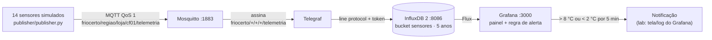

# FrioCerto — monitoramento de câmara fria (AF12, IoT e Big Data)

Laboratório da **AF12 — Atividade Formativa Integradora U1+U2** · Arquiteturas de Computação para IoT e Big Data (04803-80) · Turma 493-02AN · Prof. Giovane de Morais.

**Grupo:** _preencher nomes e RAs (3 a 4 alunos)_

## 1. Cenário

A FrioCerto é uma rede de 14 farmácias no ABC paulista (Santo André, São Bernardo, São Caetano e Diadema) que guarda insulinas, vacinas e imunobiológicos entre 2 °C e 8 °C. Depois de ser autuada pela Vigilância Sanitária por não comprovar a estabilidade da câmara fria numa queda de energia de 40 minutos, a rede precisa de monitoramento contínuo: 1 sensor de temperatura e umidade por câmara (leitura a cada 60 s), alerta imediato ao farmacêutico quando a temperatura sair da faixa por mais de 5 minutos, histórico de 5 anos para a Anvisa (RDC 430/2020) e um dashboard central, com orçamento abaixo de R$ 300/mês e Wi-Fi de loja instável em dia de chuva. Este repositório prova a cadeia ponta a ponta, localmente, com Docker Compose e 14 sensores simulados.

## 2. Arquitetura



| Serviço | Imagem | Papel |
| --- | --- | --- |
| `mosquitto` | `eclipse-mosquitto:2` | Broker MQTT |
| `influxdb` | `influxdb:2` | Banco de séries temporais (org `friocerto`, bucket `sensores`, retenção ~5 anos) |
| `telegraf` | `telegraf:latest` | Consome o MQTT e grava no InfluxDB, extraindo `regiao`, `loja` e `camara` do tópico |
| `grafana` | `grafana/grafana:latest` | Dashboard e regra de alerta, já provisionados por arquivo |

## 3. Como rodar

Pré-requisitos: Docker com Compose v2 e Python 3.9+.

```bash
git clone <URL-DO-REPOSITORIO>
cd friocerto-iot
docker compose up -d
docker compose ps            # espere os 4 serviços ficarem "healthy" (cerca de 1 minuto)
```

| Acesso | URL / endereço | Credenciais iniciais |
| --- | --- | --- |
| Grafana | http://localhost:3000 | `admin` / `friocerto123` |
| InfluxDB | http://localhost:8086 | `admin` / `friocerto123` · org `friocerto` · bucket `sensores` · token `dev-token-please-change` |
| Mosquitto | `localhost:1883` | sem autenticação (**só no laboratório**) |

Para trocar as credenciais, copie `.env.example` para `.env` e edite antes do primeiro `docker compose up`.

Depois, em outro terminal, inicie os sensores simulados:

```bash
python3 -m venv .venv
source .venv/bin/activate            # Windows: .venv\Scripts\activate
pip install -r publisher/requirements.txt
python publisher/publisher.py
```

Para parar tudo: `Ctrl+C` no publisher e `docker compose down` (use `docker compose down -v` para apagar também os dados).

## 4. Como testar a anomalia

O publisher envia uma leitura por loja a cada 2 s (em produção seria 60 s). **60 segundos depois de iniciar**, a `loja_07` passa a medir cerca de **12 °C** e assim fica por 15 minutos; depois volta ao normal.

1. Veja as mensagens chegando: `docker compose exec mosquitto mosquitto_sub -t 'friocerto/#' -v`
2. Abra o Grafana e o dashboard **FrioCerto: câmaras frias (ABC)** (pasta FrioCerto): a série da `loja_07` sobe acima da linha vermelha de 8 °C.
3. Em **Alerting → Alert rules**, a regra *Temperatura fora da faixa (2-8 °C) por mais de 5 min* passa a **Pending** em cerca de 1–2 minutos e a **Firing** cerca de 5 minutos depois (no total, de 7 a 8 minutos depois de iniciar o publisher). O histórico fica em **Alerting → History**.
4. Para outra loja ou outros tempos: `ANOMALY_LOJA=loja_03 ANOMALY_START_S=30 ANOMALY_DURATION_S=1200 python publisher/publisher.py`

## 5. Decisões técnicas justificadas

**MQTT, e qual QoS.** O sensor só publica e o broker distribui para quem assinar (Telegraf hoje; notificador e outros consumidores depois), e o broker guarda a sessão de quem reconecta depois de uma queda de Wi-Fi. As leituras usam **QoS 1**: perder uma leitura abriria um buraco no histórico da Anvisa, e uma duplicata é inofensiva porque o InfluxDB sobrescreve o ponto de mesma série e mesmo timestamp. O QoS 2 acrescentaria um handshake de 4 passos sem benefício. Em produção, o alerta usaria QoS 2, porque uma duplicata geraria várias mensagens ao farmacêutico (detalhes no relatório, A.3.b).

**InfluxDB, e não PostgreSQL.** As perguntas do negócio (minutos fora da faixa, desvio-padrão por loja) são consultas por janela de tempo e por tag. O InfluxDB tem retenção por bucket (os 5 anos da Anvisa), compressão e funções de janela nativas. O PostgreSQL daria conta de 20 mil pontos por dia, mas exigiria particionamento e índices por tempo para ter a mesma eficiência. O schema e a query Q1 estão no relatório (A.1) e em `queries/q1_minutos_fora_da_faixa.flux`.

**Mosquitto, e não EMQX.** São 14 clientes e menos de 1 mensagem por segundo. O Mosquitto é um binário leve, com configuração de poucas linhas, que roda em uma VM mínima dentro do teto de R$ 300/mês. O EMQX se justifica com cluster, milhões de conexões e regras no próprio broker, o que a FrioCerto não precisa e custaria mais memória e operação. Se um dia houver mais lojas ou alta disponibilidade, a troca é simples porque o protocolo é o mesmo.

**Telegraf entre o broker e o banco.** Evita código próprio de ingestão: um arquivo de configuração faz a assinatura, o parsing do JSON e da hierarquia do tópico (tags `regiao`, `loja` e `camara`) e a gravação. O `ts` do payload vira o timestamp do ponto, então leituras atrasadas entram com o horário original.

## 6. Estrutura do repositório

```text
docker-compose.yml                      4 serviços com healthcheck
.env.example                            credenciais opcionais
mosquitto/config/mosquitto.conf         broker MQTT
telegraf/telegraf.conf                  MQTT -> InfluxDB
publisher/publisher.py                  14 sensores simulados + anomalia
publisher/requirements.txt
grafana/provisioning/datasources/       fonte de dados InfluxDB (Flux)
grafana/provisioning/dashboards/        provedor do dashboard
grafana/provisioning/alerting/          regra de alerta
grafana/dashboards/friocerto.json       dashboard
queries/q1_minutos_fora_da_faixa.flux   query Q1 do relatório
docs/screenshots/                       capturas de tela da entrega
```

## 7. Solução de problemas

- **`docker compose ps` mostra `starting` por mais de 2 minutos:** veja `docker compose logs <serviço>`. O Telegraf e o Grafana só iniciam depois que o Mosquitto e o InfluxDB estiverem `healthy`.
- **Painel vazio:** confirme que o publisher está rodando e que o intervalo do dashboard é "últimos 15 minutos".
- **Grafana reinicia em loop (erro de provisionamento do alerta):** apague `grafana/provisioning/alerting/rules.yml`, rode `docker compose up -d --force-recreate grafana` e crie a regra pela interface: **Alerting → Alert rules → New alert rule**; fonte *InfluxDB FrioCerto*; query Flux que retorna `temp_c` por loja; expressão *Reduce → Last*; *Threshold* `IS ABOVE 8`; *Pending period* `5m`; pasta FrioCerto.
- **Porta em uso (1883, 3000 ou 8086):** pare o serviço que a usa ou troque a porta da esquerda no `docker-compose.yml`.
- **Começar do zero:** `docker compose down -v` apaga os volumes, inclusive o bucket.

## 8. Limitações do laboratório

O laboratório não é pronto para produção: o broker é anônimo e sem TLS, o InfluxDB é nó único e sem backup, o token é de administrador e fica em texto no compose, e o alerta aparece só no Grafana, sem SMS/WhatsApp, sem escalonamento e sem aviso se o próprio servidor central cair. A discussão completa está no relatório (parte C.2).
